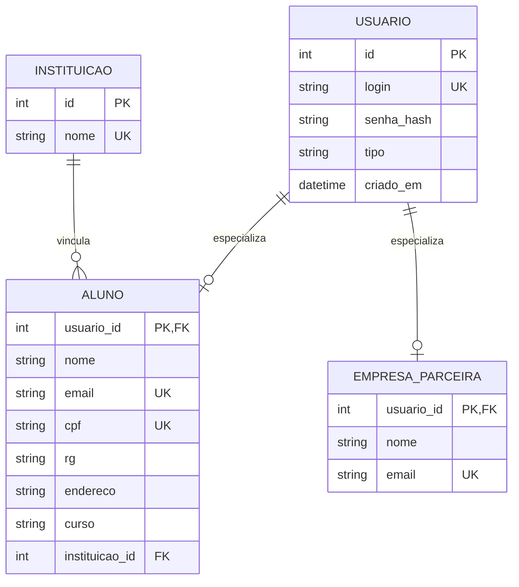

# Modelo Entidade-Relacionamento — Sprint 2

[Entrega da Sprint 2](README.md) · [Modelo de classes da Sprint 1](../modelagem/classes.md)

O modelo relacional implementa as entidades necessárias aos CRUDs iniciais. `Usuario` guarda credenciais comuns; aluno e empresa guardam seus dados específicos. A instituição é uma entidade de referência, já existente antes do cadastro do aluno.

## Chaves e cardinalidades

- `ALUNO.usuario_id` e `EMPRESA_PARCEIRA.usuario_id` são simultaneamente chave primária e estrangeira para `USUARIO.id`. Assim, cada cadastro específico possui exatamente uma identidade/login.
- Uma `INSTITUICAO` pode ter nenhum ou vários alunos; cada aluno aponta para exatamente uma instituição cadastrada.
- O login é único globalmente em `USUARIO`, inclusive entre aluno e empresa. CPF e email de aluno são únicos entre alunos; email de empresa é único entre empresas.
- A exclusão de aluno ou empresa remove sua linha específica e a identidade vinculada. A instituição usa restrição de exclusão enquanto houver alunos associados.
- A entidade permite os tipos `ALUNO`, `EMPRESA` e `PROFESSOR` para manter a classificação da superclasse modelada na Sprint 1; nesta sprint só há CRUD dos dois primeiros.

## Mapeamento relacional

| Tabela | Chave primária | Chaves estrangeiras | Restrições principais |
| --- | --- | --- | --- |
| `instituicoes` | `id` | — | `nome` único e obrigatório |
| `usuarios` | `id` | — | `login` único; `tipo` limitado aos perfis previstos |
| `alunos` | `usuario_id` | `usuarios.id`, `instituicoes.id` | CPF e email únicos; campos do cadastro obrigatórios |
| `empresas_parceiras` | `usuario_id` | `usuarios.id` | Email obrigatório e único |

Os nomes físicos preservam os termos do modelo de domínio em português. `senha_hash` guarda apenas o resultado do hash PBKDF2-SHA256 com salt aleatório, nunca a senha recebida. As definições executáveis estão em [`sprint2/models.py`](../../sprint2/models.py); `create_all` cria o esquema local na inicialização.

## Decisões da implementação

1. **ORM:** SQLAlchemy 2 mapeia as entidades e relacionamentos, reduzindo SQL específico espalhado pela aplicação.
2. **DAO:** consultas e gravações ficam nas classes `InstitutionDAO`, `StudentDAO` e `PartnerDAO`, isolando os serviços do acesso ao banco.
3. **Transação:** cada criação/edição e exclusão usa uma sessão transacional; falha ao salvar não deixa o usuário sem o cadastro específico correspondente.
4. **Banco:** SQLite facilita execução local e entrega acadêmica. `SPRINT2_DATABASE_URL` permite substituir o endereço para outro banco compatível com SQLAlchemy.
5. **Dados iniciais:** a inicialização adiciona `PUC Minas` apenas quando ainda não existe. A tabela de instituições é referência para os cadastros, não um CRUD incluído nesta sprint.

## Evolução para a Sprint 3

O banco pode receber professor/departamento, vantagens, contas e movimentações conforme o restante do modelo de classes. A associação `Usuario` → perfil pode ser reutilizada. Regras de autenticação, autorização e retenção de histórico precisam ser acrescentadas antes da exposição do sistema fora do ambiente local.
