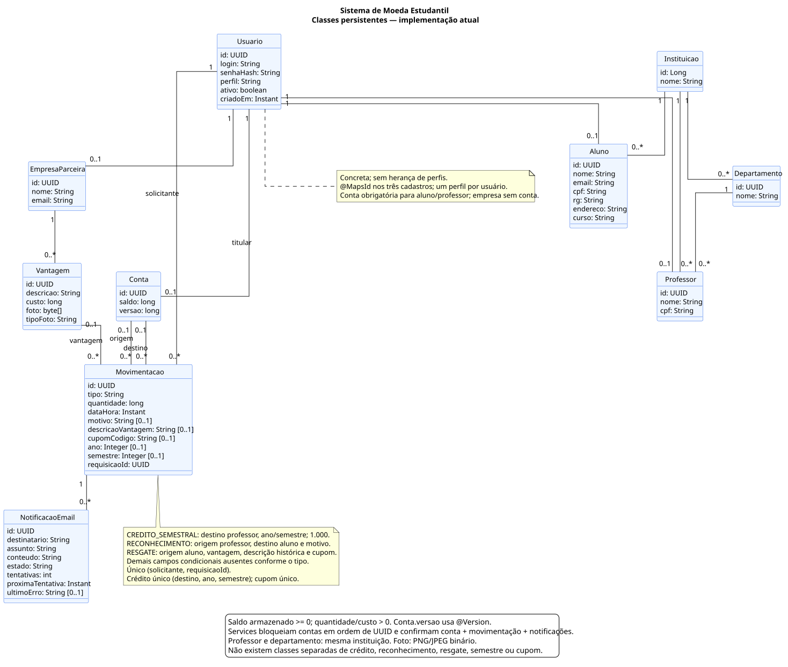

# Diagrama de classes

[Sumário](../../SUMARIO.md) · [Fonte editável](diagramas/classes.puml) · [SVG](diagramas/classes.svg) · [PNG](diagramas/classes.png)

O modelo atual acompanha as entidades persistentes da aplicação. O PDF e o HTML da sprint 1 preservam a modelagem entregue naquela etapa; esta versão incorpora as decisões de implementação.

## Identidade e vínculos

`Usuario` é uma classe concreta com UUID, login, hash da senha, perfil, situação e data de criação. `Aluno`, `Professor` e `EmpresaParceira` se associam a ela por chave primária compartilhada (`@MapsId`); não há herança JPA nem classe `TitularMoedas`. Cada usuário possui um perfil. Aluno e professor têm nome e CPF próprios e vínculo explícito com instituição; professor também possui departamento da mesma instituição (D11).

Cada aluno/professor possui uma `Conta`, cujo titular é um `Usuario` único. Empresa não possui conta. `saldo` é um inteiro de 64 bits **armazenado**, atualizado na transação da movimentação; `versao` corresponde a `@Version`. O extrato é consultado pelos vínculos de origem e destino da movimentação.

## Registro único de movimentação

`Movimentacao` é concreta. Crédito semestral, reconhecimento e resgate são valores de `tipo`, sem classes/tabelas de subtipo. Período e cupom são metadados desse registro, sem entidades `Semestre` ou `Cupom`.

| Tipo | Campos condicionais obrigatórios | Campos ausentes |
| --- | --- | --- |
| `CREDITO_SEMESTRAL` | Destino professor, quantidade 1.000, ano e semestre | Origem, motivo, vantagem e cupom |
| `RECONHECIMENTO` | Origem professor, destino aluno ativo da mesma instituição, motivo não vazio, quantidade positiva | Vantagem, cupom e período |
| `RESGATE` | Origem aluno, vantagem, quantidade igual ao custo debitado, descrição histórica e código único do cupom | Destino, motivo e período |

Todas possuem UUID, data/hora, solicitante e UUID da requisição. A unicidade `(solicitante, requisicaoId)` impede repetir um comando. O crédito é único por `(destino, ano, semestre)`. A identidade do processo dispara o crédito internamente, sem usuário administrador ou endpoint público. No registro desse crédito, o professor creditado é o solicitante e a requisição tem UUID determinística por professor/período.

Débito e crédito bloqueiam as contas em ordem de UUID e preservam saldo não negativo. O resgate guarda custo em `quantidade` e descrição em `descricaoVantagem`, conservando o histórico. O código do cupom pertence ao próprio registro do resgate e é compartilhado nos emails do aluno e da empresa.

## Vantagem e comunicação

`Vantagem` pertence a uma empresa, possui descrição, custo positivo e foto binária PNG/JPEG com seu tipo. `NotificacaoEmail` contém destinatário, assunto, conteúdo, estado, tentativas, próxima tentativa e último erro. Reconhecimento cria uma notificação; resgate cria duas. Elas são gravadas **na mesma transação** de conta e movimentação. O worker SMTP lê somente registros confirmados e repete apenas o envio; não movimenta moedas nem gera outro cupom.

As regras de autorização e as transações pertencem aos services do [modelo MVC](componentes.md). Restrições físicas e critérios de persistência estão no [modelo ER](persistencia.md); os identificadores RF/D estão em [requisitos e decisões](requisitos.md).
