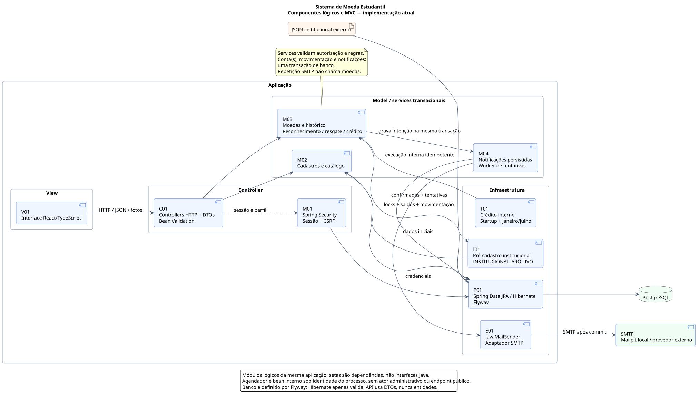

# Diagrama de componentes

[Sumário](../../SUMARIO.md) · [Fonte editável](diagramas/componentes.puml) · [SVG](diagramas/componentes.svg) · [PNG](diagramas/componentes.png)

A arquitetura segue **MVC**, exigida pelo enunciado. O diagrama representa módulos lógicos da mesma aplicação: View em React/TypeScript, controllers e services em Java/Spring Boot, persistência JPA/Hibernate e Spring Data JPA sobre PostgreSQL.

## Responsabilidades

| Componente | Responsabilidade |
| --- | --- |
| V01 — Interface web (View) | Cadastro/login, manutenção do próprio cadastro e telas das funções de cada perfil |
| C01 — Controllers e DTOs (Controller) | Receber HTTP, validar entradas, encaminhar a services e devolver DTOs |
| M01 — Acesso | Spring Security, sessão, CSRF e identificação do perfil; services também validam autorização |
| M02 — Cadastros e catálogo (Model) | Regras dos cadastros, vínculos institucionais e vantagens com foto |
| M03 — Moedas (Model) | Saldo/extrato, reconhecimento, resgate/cupom, crédito semestral e idempotência |
| M04 — Notificações (Model) | Registrar intenção de email dentro da transação da operação e processar tentativas após commit |
| P01 — Persistência | Repositories Spring Data JPA, entidades Hibernate e migrações Flyway |
| E01 — Adaptador SMTP | Enviar por `JavaMailSender` e registrar resultado do envio |
| T01 — Crédito interno | Bean do processo: inicialização e agendamento em janeiro/julho, sem endpoint público |
| I01 — Inicialização institucional | Carregar JSON externo configurado por `INSTITUCIONAL_ARQUIVO`, sem administrador ou cadastro público de professor |

As setas mostram dependências entre módulos, sem prometer interfaces Java com nomes `IRequisicoes`, `IMoedas` ou similares. Os contratos HTTP concretos estão nos controllers e DTOs; os agrupamentos do diagrama são conceituais.

## Fluxos e fronteiras transacionais

Cadastro/login passam pela View e pelo HTTP. Cadastro de aluno cria usuário, aluno e conta zero em conjunto; empresa cria usuário e empresa. Funções protegidas exigem sessão, CSRF nas alterações e autorização pelo perfil e titularidade.

Reconhecimento valida aluno ativo da mesma instituição, quantidade, motivo e saldo; bloqueia contas em ordem de UUID e grava débito, crédito, uma movimentação e uma notificação na mesma transação. Resgate valida vantagem/saldo e grava débito, resgate com custo/descrição históricos, código único e duas notificações na mesma transação.

O worker consulta notificações confirmadas e solicita o envio por E01. Mailpit é o SMTP local; SMTP externo usa variáveis de ambiente. Nova tentativa envia a mensagem persistida, sem chamar novamente o serviço de moedas. Email não é enviado antes do commit, mas a intenção de envio já foi gravada atomicamente com a movimentação.

T01 chama M03 internamente sob a identidade do processo. O serviço determina o semestre em `America/Sao_Paulo`, soma 1.000 preservando saldo e impede repetição por conta/ano/semestre. Professor que ingressa recebe o crédito do semestre corrente. I01 prepara instituições, departamentos, professores e credenciais a partir de configuração externa.

Detalhes do banco e SMTP permanecem nos adaptadores. As [decisões](requisitos.md) complementam o enunciado; a [persistência](persistencia.md) descreve o esquema e a segurança.
