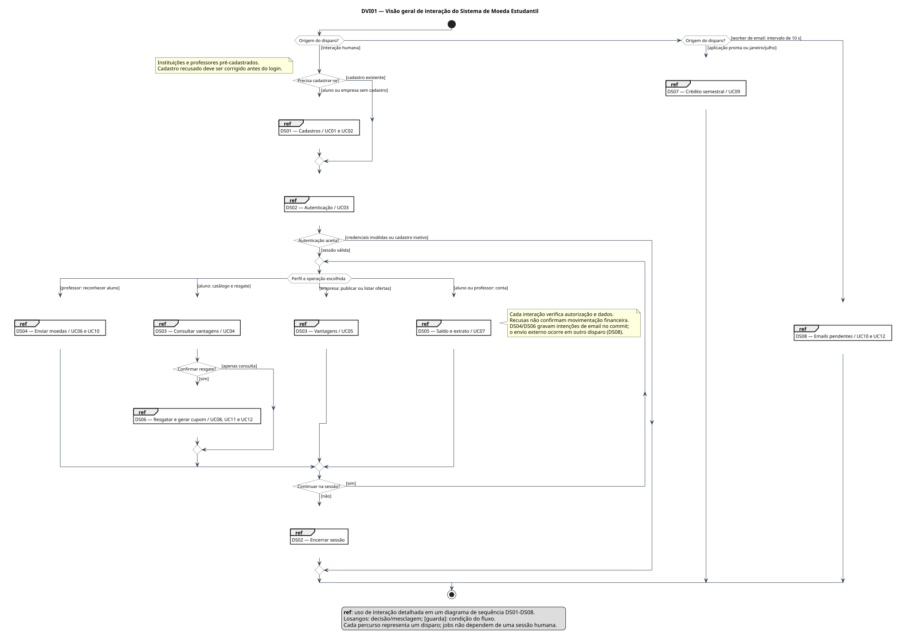
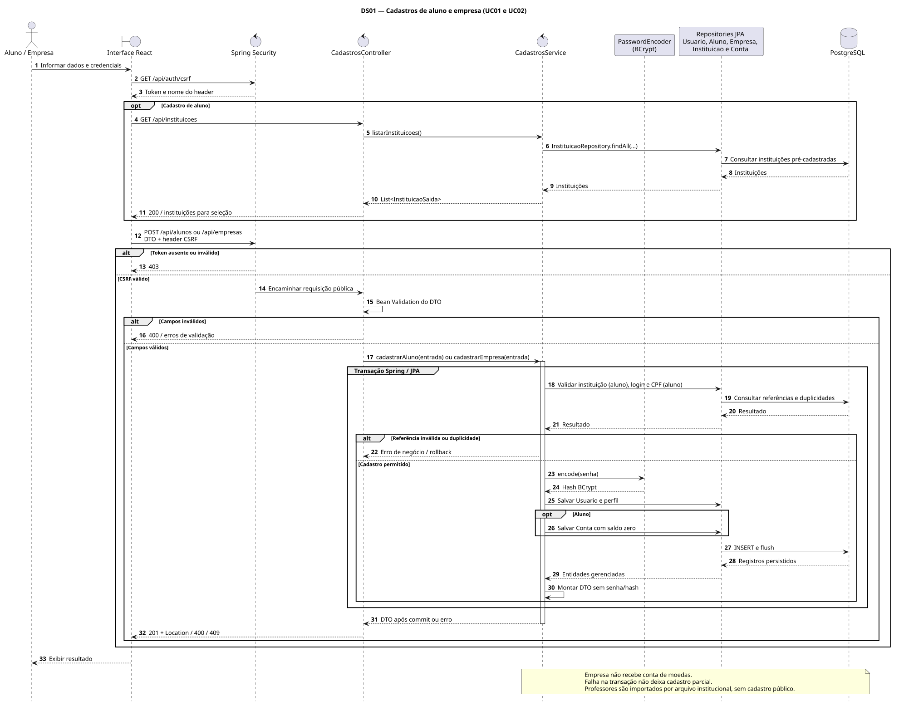
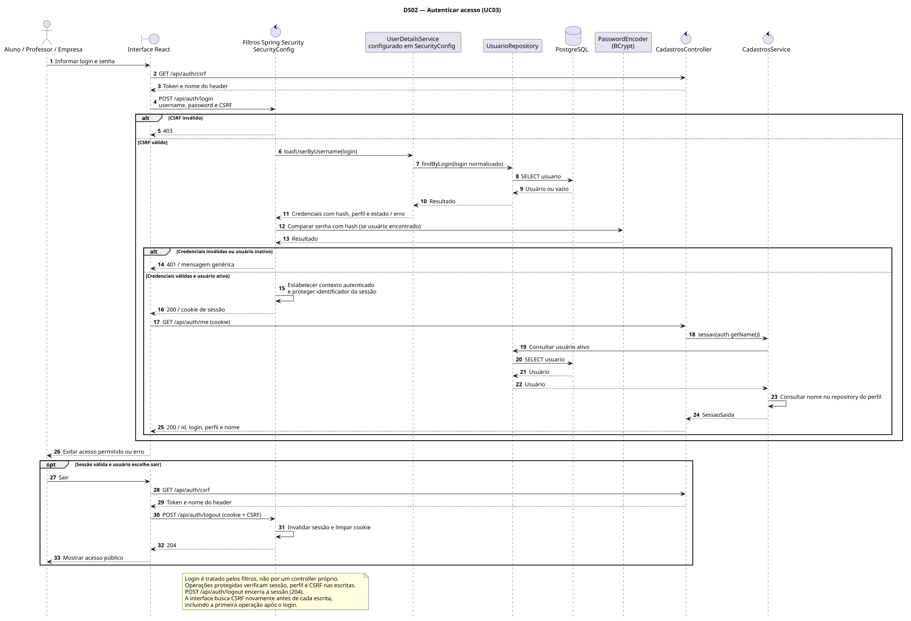
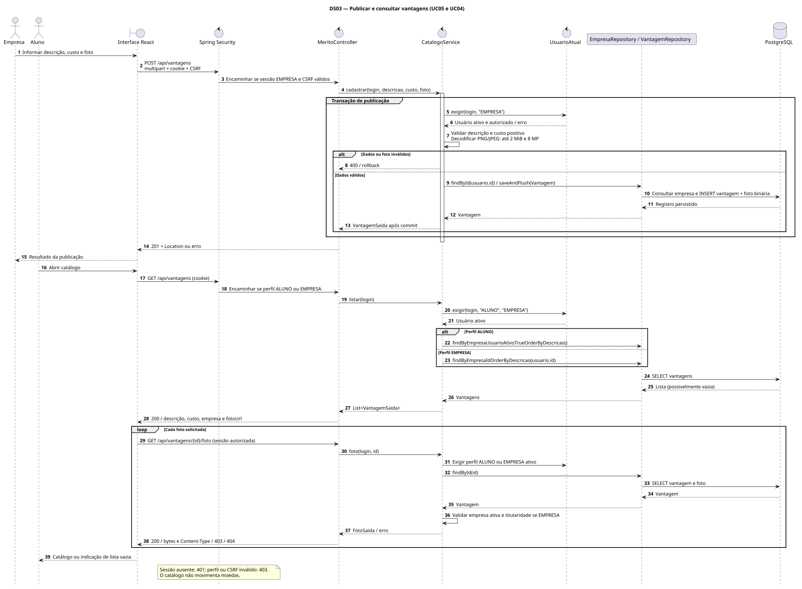
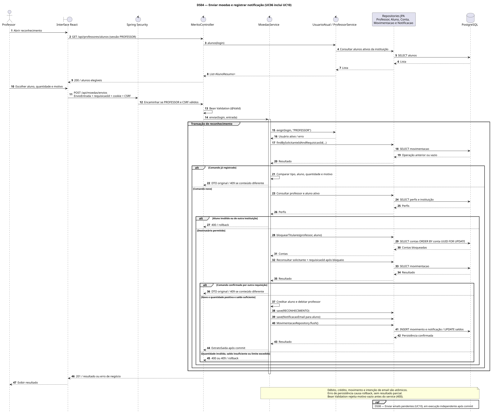
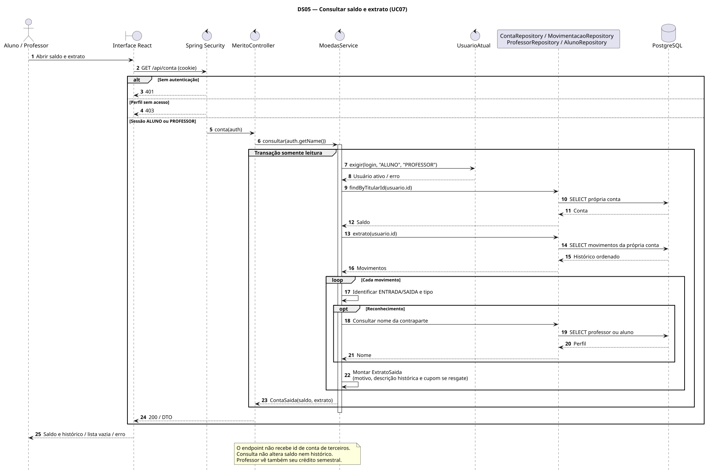
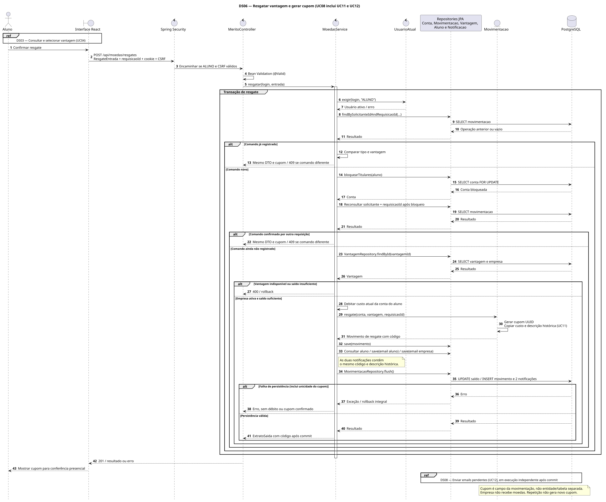
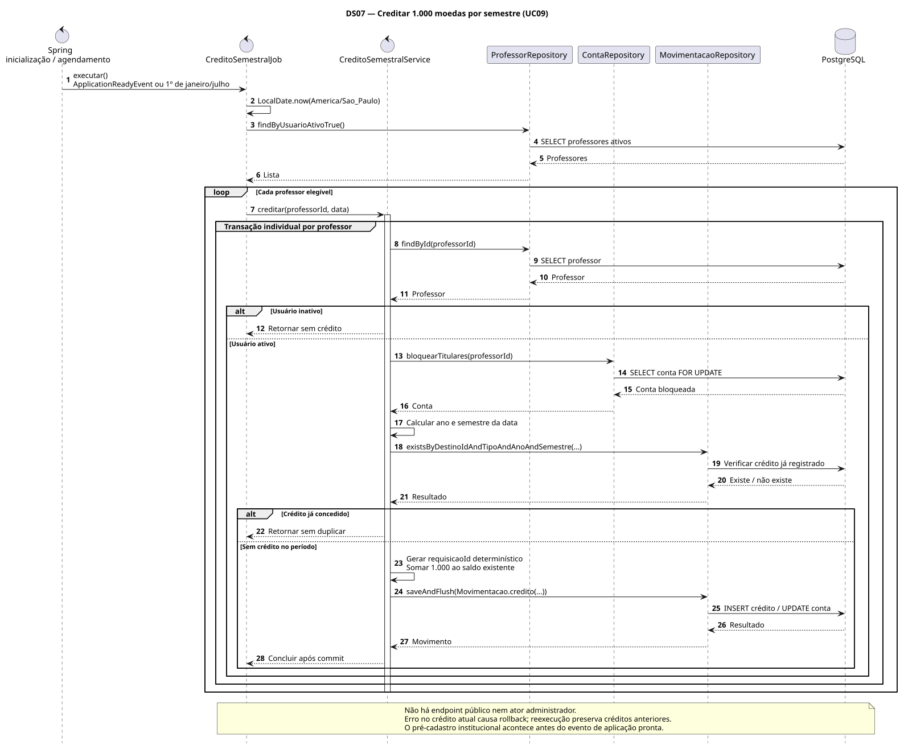
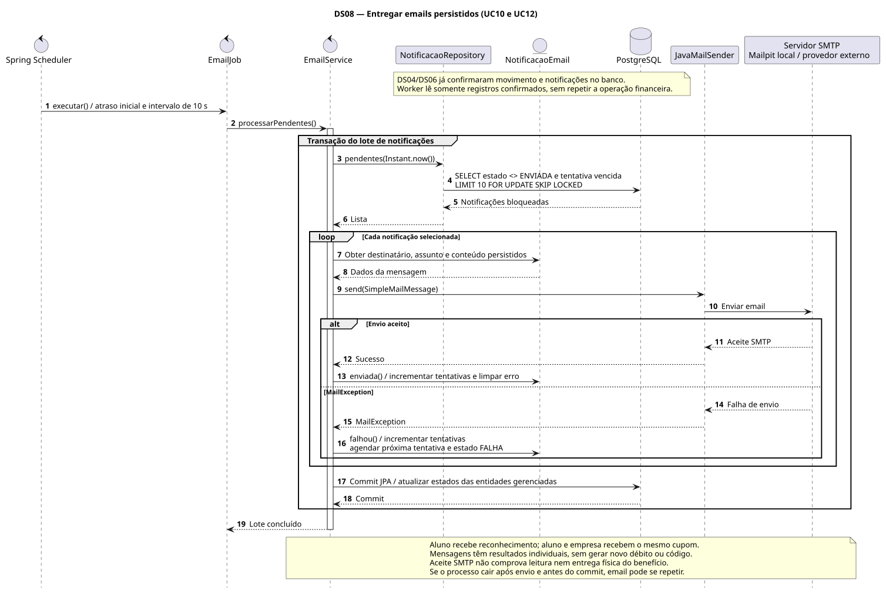

# Sequência e visão geral de interação — Lab04S01

[Sumário](../../SUMARIO.md) · [Casos de uso](casos-de-uso.md) · [Requisitos e decisões](requisitos.md)

Este documento reúne a primeira entrega da Release 02, identificada como **Lab04S01** na seção 4.4 do [enunciado do laboratório 4](../../LABORATORIO_4_LAB_DESENVOLVIMENTO_DE_SOFTWARE%20%281%29.pdf). O arquivo mantém o cabeçalho “Laboratório 3”, mas acrescenta as etapas Lab04S01–Lab04S03. A entrega pede diagramas de sequência, diagrama de visão geral de interação em UML e implementação dos casos de uso restantes da release anterior.

O código atual já contém os fluxos restantes: acesso do professor, crédito semestral, reconhecimento, saldo/extrato, vantagens com foto, resgate, código do cupom e notificações por email. Esta entrega modela essas implementações e inclui os cadastros existentes para cobrir UC01–UC12. Não cria novos atores ou operações de negócio. Implantação na nuvem e diagrama de implantação pertencem à **Lab04S02**; análise crítica e refatorações de outro grupo, à **Lab04S03**.

## Visão geral de interação

[Fonte PlantUML](diagramas/visao-geral-interacao.puml) · [SVG](diagramas/visao-geral-interacao.svg) · [PNG](diagramas/visao-geral-interacao.png)

O diagrama usa fluxo de controle de atividades, nó inicial/final, decisões com guardas e quadros **ref** de uso de interação. Cada quadro referencia um DS da tabela abaixo; não representa uma classe ou componente. A escolha de origem representa disparos independentes: ação humana, processamento de crédito ou worker de email. Assim, o processamento interno não exige login nem fica subordinado ao percurso de uma tela.

O login é precondição das funções protegidas. Uma sessão permite várias operações do próprio perfil. As recusas e os efeitos transacionais aparecem nos diagramas de sequência; o percurso geral retorna à escolha de operação quando a sessão continua. O envio externo de email não faz parte da transação financeira: DS04/DS06 persistem a intenção, e DS08 processa os registros confirmados.

## Diagramas de sequência e rastreabilidade

| Diagrama | Casos de uso / requisitos | Implementação correspondente |
| --- | --- | --- |
| [DS01 — Cadastros](#ds01--cadastros) | UC01, UC02; RF01, RF02, RF10, RF16 | `CadastrosController`, `CadastrosService`, repositories de cadastros e `PasswordEncoder` |
| [DS02 — Autenticação](#ds02--autenticação) | UC03; RF16, RF03 como precondição | `SecurityConfig`, `UsuarioRepository`, sessão em `CadastrosController`/`CadastrosService` |
| [DS03 — Vantagens](#ds03--vantagens) | UC04, UC05; RF09, RF11 | `MeritoController`, `CatalogoService`, `VantagemRepository` |
| [DS04 — Reconhecimento](#ds04--reconhecimento) | UC06 inclui UC10; RF05, RF06 | `ProfessorService`, `MoedasService.enviar`, repositories de contas, movimentos e notificações |
| [DS05 — Saldo e extrato](#ds05--saldo-e-extrato) | UC07; RF07, RF08 | `MeritoController`, `MoedasService.consultar` |
| [DS06 — Resgate e cupom](#ds06--resgate-e-cupom) | UC08 inclui UC11 e UC12; RF12–RF15 | `MoedasService.resgatar`, `Movimentacao.resgate`, `NotificacaoRepository` |
| [DS07 — Crédito semestral](#ds07--crédito-semestral) | UC09; RF04 | `CreditoSemestralJob`, `CreditoSemestralService` |
| [DS08 — Emails](#ds08--emails) | UC10, UC12; RF06, RF14, RF15 | `EmailJob`, `EmailService`, `NotificacaoRepository`, `NotificacaoEmail`, `JavaMailSender` |

Os fontes Java estão nos pacotes [cadastro](../../backend/src/main/java/br/pucminas/moedaestudantil/cadastro/), [merito](../../backend/src/main/java/br/pucminas/moedaestudantil/merito/) e [config](../../backend/src/main/java/br/pucminas/moedaestudantil/config/). A interface fica em [frontend/src](../../frontend/src/). RF identifica o enunciado; os detalhes de autorização, concorrência, semestre e persistência seguem as decisões D01–D15, sem tratá-las como exigências literais da disciplina.

### Convenções

- Linhas de vida representam atores e instâncias dos componentes existentes; os repositories agrupados são uma simplificação visual, não uma nova classe de acesso a dados.
- Setas contínuas indicam chamadas/mensagens; tracejadas indicam retorno. `alt`, `opt` e `loop` representam alternativas, comportamento opcional e repetição. `ref` referencia outra interação.
- Os grupos de transação abrangem o método de service interceptado pelo Spring. O commit ocorre antes do retorno ao controller; exceções revertem os efeitos da operação. Entidades gerenciadas têm alterações persistidas por JPA no flush/commit.
- Controllers recebem e retornam DTOs; React apresenta os resultados. Spring Security trata sessão, perfil e CSRF; services revalidam usuário ativo e regras. Repositories acessam PostgreSQL via JPA.
- As chamadas de autorização e consultas auxiliares podem agrupar acessos internos para manter os diagramas legíveis. Os fluxos não substituem o código nem constituem evidência de execução de testes.

### DS01 — Cadastros

[Fonte](diagramas/sequencia-cadastros.puml) · [SVG](diagramas/sequencia-cadastros.svg) · [PNG](diagramas/sequencia-cadastros.png)

Preserva os cadastros da Release 01: aluno seleciona instituição existente e recebe conta zerada; empresa não recebe carteira. A senha é transformada em hash BCrypt e não aparece no DTO de saída. Alteração e inativação continuam disponíveis somente ao titular, conforme UC e D15 existentes; exclusão conserva o histórico. Professores são pré-cadastrados por importação institucional, fora do cadastro público.

### DS02 — Autenticação

[Fonte](diagramas/sequencia-autenticacao.puml) · [SVG](diagramas/sequencia-autenticacao.svg) · [PNG](diagramas/sequencia-autenticacao.png)

O processamento do login é do Spring Security. A interface obtém CSRF, envia formulário de credenciais e consulta o perfil da sessão. Antes de cada operação de escrita, busca o token novamente, inclusive após autenticação. Credenciais inválidas e cadastro inativo recebem resposta genérica. Não há controller fictício de autenticação de senha.

### DS03 — Vantagens

[Fonte](diagramas/sequencia-catalogo.puml) · [SVG](diagramas/sequencia-catalogo.svg) · [PNG](diagramas/sequencia-catalogo.png)

A empresa autenticada publica vantagem em seu próprio nome. O service valida descrição, custo positivo e foto PNG/JPEG de até 2 MiB e 8 megapixels. O aluno vê ofertas de empresas ativas; a empresa lista somente suas ofertas. Consulta e seleção não debitam saldo.

### DS04 — Reconhecimento

[Fonte](diagramas/sequencia-envio-moedas.puml) · [SVG](diagramas/sequencia-envio-moedas.svg) · [PNG](diagramas/sequencia-envio-moedas.png)

O professor escolhe aluno ativo da mesma instituição (D09) e informa quantidade e motivo obrigatório. A transação bloqueia contas em ordem do UUID da conta, verifica novamente a identificação do comando e confirma débito, crédito, movimento e notificação juntos. Repetir um comando com o mesmo conteúdo retorna o registro original; reutilizar o UUID com conteúdo diferente gera conflito. O envio SMTP fica em DS08.

### DS05 — Saldo e extrato

[Fonte](diagramas/sequencia-extrato.puml) · [SVG](diagramas/sequencia-extrato.svg) · [PNG](diagramas/sequencia-extrato.png)

O usuário consulta somente a própria conta. O extrato distingue crédito semestral, reconhecimento enviado/recebido e resgate, incluindo motivo e código do cupom quando cabíveis. Empresa não tem conta; a API não permite escolher o id de outra pessoa.

### DS06 — Resgate e cupom

[Fonte](diagramas/sequencia-resgate.puml) · [SVG](diagramas/sequencia-resgate.svg) · [PNG](diagramas/sequencia-resgate.png)

O service bloqueia a conta do aluno, revalida idempotência, disponibilidade e saldo, debita o custo e cria uma movimentação com código UUID, custo e descrição históricos. O cupom é um campo dessa movimentação; não há entidade separada nem crédito para a empresa. As duas intenções de email contêm o mesmo código e integram a transação do resgate. Falha de persistência desfaz toda a operação. Uma colisão do código é recusada pela restrição única do banco; a implementação atual não faz nova geração automática dentro da mesma tentativa.

### DS07 — Crédito semestral

[Fonte](diagramas/sequencia-credito-semestral.puml) · [SVG](diagramas/sequencia-credito-semestral.svg) · [PNG](diagramas/sequencia-credito-semestral.png)

Processamento interno na inicialização e em janeiro/julho, em `America/Sao_Paulo` (D04). Cada professor ativo é tratado em transação própria: bloqueio da conta, verificação do crédito do período e soma de 1.000 ao saldo restante. Não existe endpoint administrativo de crédito. Reexecução ignora créditos já confirmados.

### DS08 — Emails

[Fonte](diagramas/sequencia-emails.puml) · [SVG](diagramas/sequencia-emails.svg) · [PNG](diagramas/sequencia-emails.png)

O worker consulta até dez notificações elegíveis por lote, bloqueadas com `SKIP LOCKED`. Cada mensagem tem resultado individual; falha de SMTP agenda nova tentativa sem novo débito ou cupom. O reconhecimento produz um email para o aluno; o resgate produz dois, para aluno e empresa. O envio oferece repetição de tentativas, não garantia de email exatamente uma vez: queda após aceite SMTP e antes do commit pode repetir a mensagem. Mailpit captura mensagens locais; entrega externa depende da configuração SMTP.

## Conferência e apresentação

Verificações concluídas nesta entrega: sintaxe PlantUML dos nove diagramas, exportações SVG/PNG, links locais da documentação, build Java com testes ignorados, build React, lint e formatação. Todas passaram. A campanha completa de testes e a demonstração com PostgreSQL/SMTP devem ser realizadas na etapa de testes definida pelo grupo. Compilar não comprova todos os critérios de aceitação em execução.

Para apresentar: abrir DVI01 para explicar os três tipos de disparo; mostrar DS04 e DS06 para justificar transações e idempotência; mostrar DS08 para separar confirmação financeira de entrega de email; usar a tabela de rastreabilidade para localizar os demais casos no código. Os comandos de execução, verificação e atualização dos diagramas ficam no [README](../../README.md).

Referência de notação do DVI: [documentação de visão geral de interação do draw.io](https://www.drawio.com/docs/diagram-types/uml/interaction-overview/). A sintaxe dos diagramas de sequência segue a [documentação do PlantUML](https://plantuml.com/sequence-diagram).
