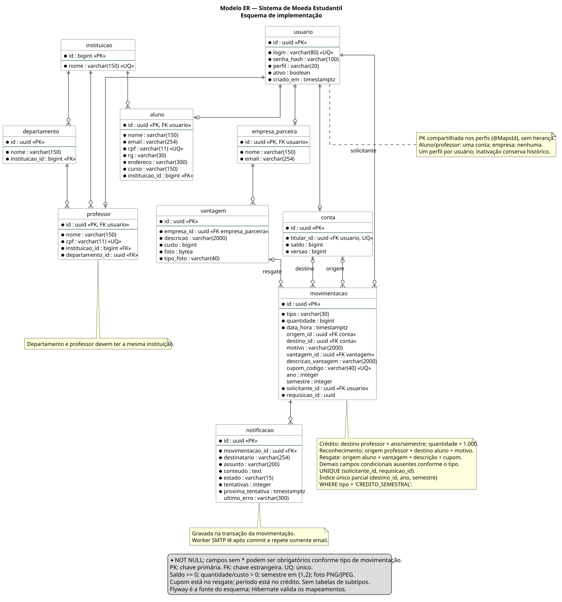

# Modelo ER e persistência

[Sumário](../../SUMARIO.md) · [Código do diagrama](diagramas/modelo-er.puml) · [SVG](diagramas/modelo-er.svg) · [PNG](diagramas/modelo-er.png)

O diagrama acompanha o esquema de implementação do sistema. As [migrações Flyway](../../backend/src/main/resources/db/migration/) são a fonte do esquema executável; alterações acrescentam versões, sem reescrever migrações aplicadas. O PDF da sprint 1 permanece como registro histórico.

## Estratégia de persistência e MVC

Jakarta Persistence (JPA), implementada por Hibernate, mapeia as entidades; interfaces Spring Data JPA acessam o PostgreSQL real. Não há DAO paralelo nem H2 como substituto dos testes de integração. Flyway aplica alterações e `spring.jpa.hibernate.ddl-auto=validate` verifica o mapeamento, sem gerar esquema.

React apresenta a View; controllers recebem HTTP e DTOs; services validam autorização/regras e delimitam transações; repositories acessam o banco. Bean Validation verifica entradas. `open-in-view=false` evita consultas implícitas na serialização. Entidades JPA e hashes de senha não são respostas da API.

`Usuario` é concreto. Aluno, empresa e professor usam seu UUID como PK e FK (`@MapsId`), por associação, sem herança. Aluno e professor possuem instituição explícita; o departamento do professor pertence à mesma instituição. Cada aluno/professor possui uma conta com titular único, saldo `bigint` armazenado e versão `@Version`; empresa não possui conta.

O cadastro do aluno confirma usuário, aluno e conta com saldo zero; o da empresa confirma usuário e empresa. Restrições `UNIQUE`, `NOT NULL`, `CHECK` e FKs complementam a validação. Duplicidade produz conflito e rollback. Login é normalizado para minúsculas. CPF tem 11 dígitos e unicidade; não há consulta de cadastros externos.

## Transações de moedas

Há uma tabela `movimentacao`, discriminada por `tipo`; não há tabelas separadas de crédito, reconhecimento, resgate, semestre ou cupom. A [tabela de campos condicionais](classes.md) detalha cada tipo. O código único do cupom é armazenado no próprio resgate, junto à quantidade debitada e à descrição histórica da vantagem. Foto da vantagem é `bytea`, com tipo PNG/JPEG.

Services usam bloqueio pessimista nas contas, em ordem de UUID quando envolvem duas contas, revalidam saldo e confirmam **conta(s), movimentação e notificações na mesma transação**. Saldo não pode ficar negativo. A coluna de versão permanece como controle adicional de alteração da conta.

A unicidade `(solicitante_id, requisicao_id)` protege contra repetição de comando. Um índice único parcial em `(destino_id, ano, semestre)`, para `CREDITO_SEMESTRAL`, impede crédito duplicado. Nesse registro, o solicitante é o professor creditado e a requisição usa UUID determinística para professor/período, sem criar usuário técnico. O crédito soma 1.000 ao saldo existente; não zera a conta. O bean interno executa na inicialização e em janeiro/julho, usa `America/Sao_Paulo` para ano/semestre e contempla professor que ingressa no semestre corrente. Não existe endpoint público para esse processamento.

## Notificações e SMTP

O reconhecimento grava uma notificação ao aluno; o resgate grava duas, para aluno e empresa, com o mesmo cupom. `notificacao` persiste destinatário, assunto, conteúdo, estado, tentativas, próxima tentativa e último erro. O worker lê somente registros confirmados e usa `JavaMailSender`. Falha/repetição de envio não refaz débito, crédito ou cupom. O envio externo não integra a transação do banco; sua intenção persistida integra.

Mailpit atende o ambiente local; SMTP externo é configurado por variáveis de ambiente. Não há email de boas-vindas nem confirmação digital de utilização do cupom.

## Cadastros e segurança

- Cadastro inicial de aluno/empresa e login são públicos. Demais operações exigem sessão, CSRF e perfil autorizado. Cada usuário consulta, atualiza e inativa apenas seu cadastro; a listagem de cadastros não expõe colegas. O professor consulta alunos ativos da mesma instituição para reconhecer (D09).
- BCrypt protege senhas; a política existente usa mínimo de 8 caracteres e máximo de 72 bytes UTF-8. Sessão usa cookie HttpOnly. O cliente obtém CSRF antes de alterações.
- Exclusão significa inativação, conservando dados, histórico, login e CPF reservados. Sessões de usuário inativo não autorizam operações. Não há reativação ou administrador nesta versão.
- Nome e email são os campos mínimos da empresa. Login/senha não são editáveis pelo CRUD do próprio cadastro.
- Instituições, departamentos e professores são preparados por arquivo institucional JSON externo indicado em `INSTITUCIONAL_ARQUIVO`, sem cadastro público de professor. A base PUC Minas existente é preservada; o template de desenvolvimento contém somente dados fictícios. As credenciais de operação ficam fora do repositório.

São decisões do grupo, separadas das exigências RF em [requisitos e decisões](requisitos.md). O significado de “seus alunos” continua sujeito à confirmação acadêmica; a aplicação adota mesma instituição.

## Verificação

Comandos de execução e verificação ficam no [README](../../README.md). Testes de integração usam PostgreSQL real. A aplicação deve preservar autorização por perfil, rollback, saldo não negativo, unicidade do comando e do crédito semestral, além de permitir repetir somente notificações após falha SMTP.
